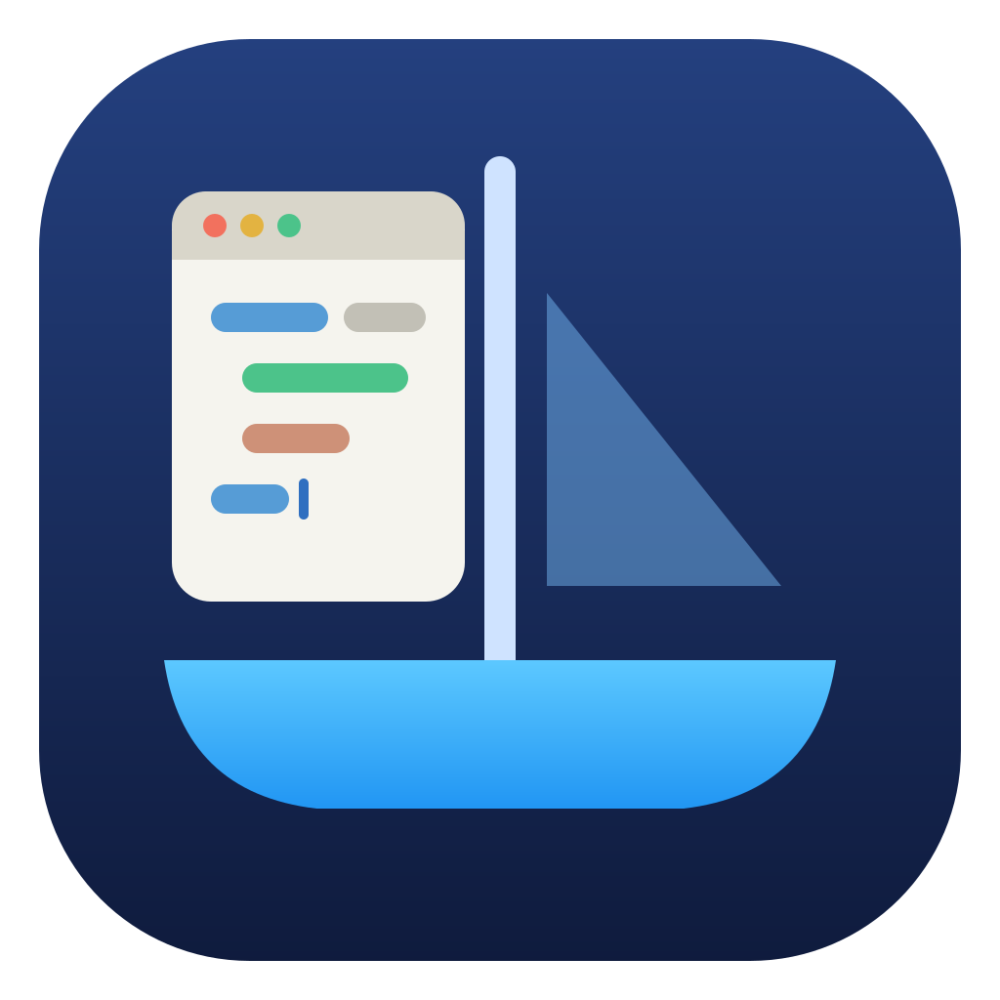
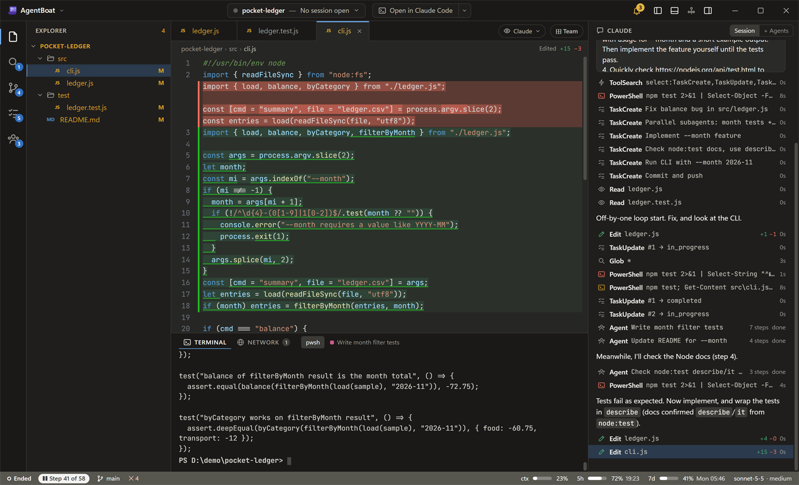
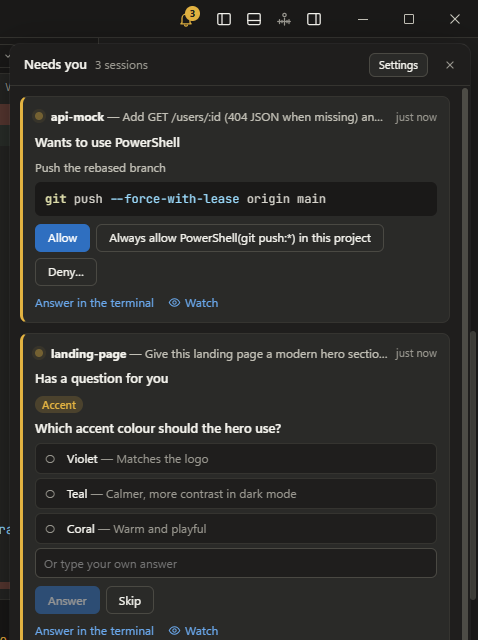
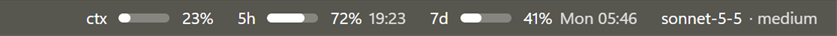
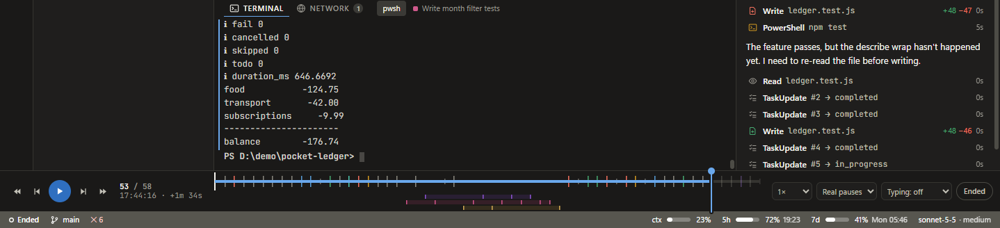
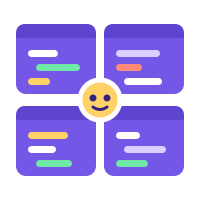
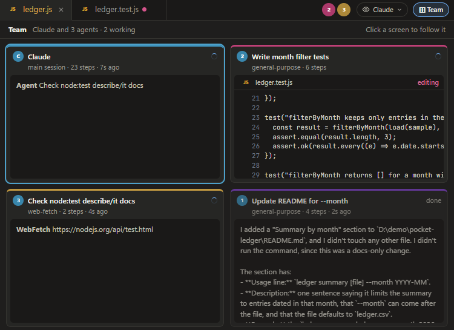
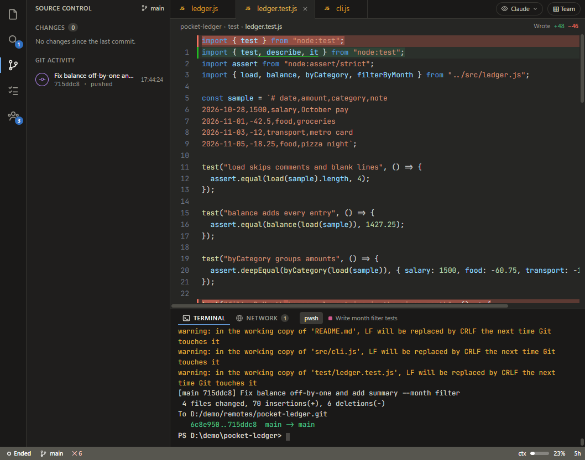
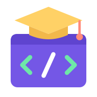
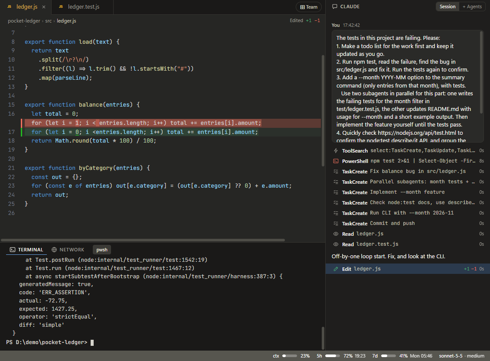

<p align="center">
  
</p>

<h1 align="center">AgentBoat</h1>

<p align="center">
  <b>Your Claude Code sessions, as an IDE you can watch. Live, or in flashback.</b><br>
  Read-only · local · free and open source · Windows (macOS soon)<br>
  <a href="https://github.com/yash-desai-naik/agentboat/releases/latest"><b>Download</b></a> ·
  <a href="#what-you-see">Features</a> ·
  <a href="#coming-from-ccboat">Coming from Ccboat?</a>
</p>

> **Formerly Ccboat.** Same app, new name, from version 0.6.0. Using Ccboat? It updates itself to
> AgentBoat and brings your settings along.



Eight Claude Code terminals open, three waiting on you, one just pushed to `main`, and no idea
which one burned your 5-hour limit? AgentBoat is the screen you glance at. Edits are **typed out in
the editor**, commands run in the terminal, commits land in Source Control: follow Claude **live**,
or **rewind and replay** any session. It only watches; it never touches your code.

<sub>Screenshots: real AgentBoat, watching real Claude Code sessions on a small demo project.</sub>

## Made for vibe coders running a fleet

<table>
<tr>
<td width="84"></td>
<td><b>Dozens of sessions, one window.</b> The <b>Needs you</b> bell gathers every session that's
waiting on you. Approve a command, answer Claude's question or sign off on a plan right there, with
no terminal hunting.</td>
</tr>
</table>

<p align="center"></p>

<table>
<tr>
<td width="84"></td>
<td><b>Tokenmaxing, meter in view.</b> Context used, your 5-hour and weekly limits with their reset
times, the model and its effort. See the wall before you hit it.</td>
</tr>
</table>



<table>
<tr>
<td width="84"></td>
<td><b>Flashback.</b> Back from lunch to 40 changed files? Scrub the timeline, jump prompt to prompt,
or press Space and replay it at 0.1× to 16× with the session's real pauses.</td>
</tr>
</table>



<table>
<tr>
<td width="84"></td>
<td><b>Team view for agent swarms.</b> Ctrl+Shift+T puts Claude and every subagent on screen at
once, each with the file it's editing.</td>
</tr>
</table>

<p align="center"></p>

<table>
<tr>
<td width="84"></td>
<td><b>Review before you trust.</b> Every edit as an inline diff, every touched file marked in the
Explorer, every commit and push in Source Control.</td>
</tr>
</table>

<p align="center"></p>

## Learn to code by watching an agent work

<table>
<tr>
<td width="84"></td>
<td>New to coding, or to a codebase? Replay a session slowly and see how a capable agent works: what
it reads first, how it reads a failing test, and the one-character fix that turns it green.
Pair programming you can pause and rewind.</td>
</tr>
</table>



## Light, local, private

<table>
<tr>
<td width="84"></td>
<td><b>Read-only</b>: it reads Claude Code's transcripts in <code>~/.claude</code>.
<b>Local</b>: the only network call is the update check. <b>Light</b>: about 200 MB of memory,
built with <a href="https://tauri.app">Tauri 2</a>, no Electron. A sibling of
<a href="https://github.com/yash-desai-naik/fileboat">Fileboat</a> and
<a href="https://github.com/yash-desai-naik/tableboat">Tableboat</a>.</td>
</tr>
</table>

## Download

**Windows 10 and 11:** the installer is on the
[Releases page](https://github.com/yash-desai-naik/agentboat/releases/latest)
(`AgentBoat_x.y.z_x64-setup.exe`). It installs for your user only, no administrator rights needed. It
isn't code-signed yet, so SmartScreen may ask: **More info**, then **Run anyway**. Each release
lists the file's SHA-256 checksum. You need [Claude Code](https://claude.com/claude-code) on the
same machine; AgentBoat shows its sessions.

AgentBoat keeps itself up to date: it tells you when a new version is out (**AgentBoat ▾** in the title bar
→ **Check for updates**), shows what's new, and installs it in place. Version 0.1.0 predates the
updater, so install 0.2.0 or later from the Releases page once by hand.

A macOS build will follow (it compiles, but hasn't been run on a Mac yet).

On first start, a welcome offers the two optional extras (below), and opening your first session
starts a short tour of six stops; skip it any time, or take it again from **AgentBoat ▾ → Quick
tour**. Press **?** for every keyboard shortcut.

### Coming from Ccboat

AgentBoat was called Ccboat up to version 0.5.1 ([old repository](https://github.com/yash-desai-naik/ccboat)).
You don't need to do anything:

1. Ccboat offers one last update (**Ccboat ▾ → Check for updates**, or it tells you itself). It
   installs AgentBoat and opens it.
2. On its first start AgentBoat moves you in: it copies Ccboat's settings (layout, replay speed, the
   last session, your saved status line), points **Answer prompts** and **Show usage limits** in
   Claude Code's `settings.json` at AgentBoat (same port and token, so nothing to turn on again),
   removes the old Ccboat install, and puts AgentBoat in the Start menu (and on the desktop, if
   Ccboat was there).

Prefer to do it by hand? Install AgentBoat from the
[Releases page](https://github.com/yash-desai-naik/agentboat/releases/latest) and start it: it does
the same. A taskbar pin to Ccboat stops working once Ccboat is removed; pin AgentBoat instead.
Ccboat's own data folder (`%LOCALAPPDATA%\app.ccboat`) is left in place; delete it once you're happy.

## What you see

- **Editor.** A tab opens for each file Claude reads or changes. Reads open the file at the lines
  read, with their real line numbers. Edits show as an inline diff (green added, red removed).
  While following live or playing a replay, the edit is acted out: the old text is selected and
  removed, the new text typed in at a moving caret, then the diff appears. Images Claude reads
  are shown.
- **Browser.** Web fetches open a browser tab per site: an address bar, what Claude was reading
  for, and the page as a readable document. Web searches open a results page (site, title, link).
- **Explorer.** Every file Claude has touched up to the current step, as a tree under the project
  folder, marked **R** (read), **M** (modified), **A** (added) or **D** (deleted). That includes
  files written from the terminal (`cat > f <<'EOF'`, `>`/`>>`, `tee`, `cp`, `mv`, `rm`, `sed -i`,
  PowerShell's `Set-Content`, `Out-File`, `Copy-Item`…); a heredoc's file opens in the editor
  with its content. Files outside the project are grouped by folder.
- **Terminal.** Each command typed at a prompt (`PS D:\…>` for PowerShell, `/d/… (branch) $` for
  Bash) with what it printed, interrupted and background commands marked. One terminal per
  subagent. Commands are highlighted as a shell with syntax highlighting would (programs, flags,
  strings, variables, operators, comments; heredoc bodies dimmed). Output keeps a program's own
  colours; plain output is coloured by what it says: errors red, warnings amber, passes green,
  `file:line` locations, diffs and `git status` in git's colours.
- **Network** (beside Terminal). Every MCP tool call, web request and other tool call, as a
  browser's DevTools lists requests: server, call, status, time and size. The selected call shows
  its request and response. The response is shown by the shape of its data, for any server: a
  record (a task, a pull request, a page) as a card with its title, status badges, people and
  fields; a list as a table; text as markdown; anything else as a JSON tree.
- **Questions and commands.** When Claude asks you something, the question appears as a dialog
  over the editor, with the answer you gave. Skills and tool searches flash up in a command
  palette at the top of the editor.
- **Search.** Claude's Grep and Glob searches with their results grouped by file.
- **Source Control.** Files changed since the last commit, and the git activity: commits (message
  and hash), pushes and pulls (remote and range), branch switches, stashes, worktrees, `gh pr`.
  The status bar counts commits not pushed yet.
- **Tasks and Subagents.** Claude's task list as of the current step; each subagent with what it
  is doing.
- **Claude panel.** Your prompts, Claude's replies, and each tool call as a line (with time
  taken and lines changed). Click any line to jump there. *+ Agents* shows subagents' steps too.
- **Needs you** (the bell in the title bar). Every running session that is waiting on you, from
  any of your sessions. With **Answer prompts in AgentBoat** on (**AgentBoat ▾**), its prompts are
  answered right there: a tool's permission (Allow, Always allow the rule Claude Code offers, or
  Deny with what to do instead), Claude's questions (pick options or type your own answer), a plan
  (Approve, or Keep planning with feedback). The terminal shows the same prompt; whichever you
  answer first counts. Sessions waiting in their terminal and ones that just finished their turn
  are listed too. The panel opens when something new needs you, and the taskbar button flashes.
- **Open in Claude Code** (title bar, and on each session in the session list): a running
  session's terminal window comes to the front; a finished one is resumed in a new terminal in its
  folder (`claude --resume <id>`). A running session can't be sent a new prompt from outside, so
  this is how you reply to one that finished its turn. The ▾ beside it opens the session's folder in
  **VS Code** or **Zed** (whichever are installed) or copies its path.
- **Right-click** any file or folder (tabs, breadcrumb, Explorer, Search, Source Control, the
  Claude panel, `file:line` in the terminal, the session list): copy its path, relative path or path
  with the line, or open it in VS Code or Zed at that line. Selected text can be copied too.
- **Status bar.** The session's state, branch, permission mode, the context in use as a share of
  the window (a bar and a percentage), and the model with its reasoning effort. With **Show usage
  limits** on (**AgentBoat ▾**), also your 5-hour and weekly usage, each with a bar and when it
  resets.
- **Timeline** (hidden until you want it: the timeline button in the title bar, or Ctrl+T; while
  it's hidden the status bar shows Replay or Step n of m when you're not watching the present, and
  the keys below still work).
  Every step as a mark (prompts tall; reads blue, edits green, commands amber, git
  purple, failures red; subagents underneath). Drag to scrub, or step:

  | Key | |
  |---|---|
  | ← / → | step back / forward |
  | Shift + ← / → | previous / next prompt |
  | Space | play / pause |
  | End | go live (follow Claude) |
  | Home | first step |
  | Ctrl+O | open another session |
  | Ctrl+T | show / hide the timeline |
  | Alt+Z | wrap long lines in the editor |
  | Ctrl+Shift+T | team view: every agent's screen at once |
  | Esc | back to Claude's screen, when following an agent |
  | Ctrl+B / J / L | side bar / terminal / Claude panel |

  Replay speed (0.1× to 16×), *Real pauses* (the session's own timing, long gaps shortened) or
  *Even steps*, and the typing animation (normal, fast, off) are set beside it.

The session list (Ctrl+O) shows running sessions first, then the most recent ones; **Show older
sessions** at its end lists more.

Running sessions open following live: each new step appears within a quarter of a second of
Claude Code writing it. If Claude moves faster than the animations, the view skips ahead rather
than falling behind. Step
back and following pauses; **Go live** resumes. Finished sessions open at their last step, ready
to replay.

## Light on resources

Measured on Windows 11 (release build, 12 cores), details in
[docs/DEVELOPMENT.md](docs/DEVELOPMENT.md#memory-and-cpu):

- **~200 MB** of memory in all (about 265 MB replaying a 20 MB transcript), most of it the
  system WebView's own processes; the app itself is ~15 MB.
- Following a live session: **5–9% of one core** while Claude is idle (under 1% of the machine),
  about 13% while it works; **0.7%** while minimized.
- Replaying with the typing animation: 25% of one core at 1×, 35% at 4×.

## What it can't show

AgentBoat sees what Claude Code writes to its transcript, so:

- A command's output appears when the command finishes (the transcript doesn't record output
  while a command runs).
- Claude's thinking is shown as "Thinking…" only: Claude Code stores it redacted.
- "Changes since the last commit" is worked out from the session (a commit clears the list); it
  isn't read from git.
- What a script does inside (`python - <<'EOF'` editing a file) can't be seen from its command
  line, so those changes don't appear; nor do the files of a whole-folder copy (`cp -r`).
- Files are shown as Claude saw them: what it read, and its edits applied to that. A file Claude
  edited without reading shows the edit itself (or the patch Claude Code logged).

## Where the data comes from

Only from `~/.claude` (or `CLAUDE_CONFIG_DIR`), read-only:

- `sessions/<pid>.json`: which sessions are running and whether they're working, idle or waiting
  for you;
- `projects/<folder>/<sessionId>.jsonl`: the transcript, read as it grows;
- `projects/<folder>/<sessionId>/subagents/agent-<id>.jsonl` and `.meta.json`: subagents.

It never writes anywhere (except its own window settings in the WebView's storage), with one
exception you turn on yourself: **Answer prompts in AgentBoat** adds one hook to Claude Code's
`settings.json`, and turning it off removes it (nothing else in the file changes; a copy of the file
from before is kept as `settings.json.agentboat-backup`). It is an `http` `PermissionRequest` hook:
Claude Code sends each prompt to AgentBoat on `127.0.0.1:47821` and waits for your answer while the
terminal shows the prompt too. Requests must carry a random token written into the hook, and
requests from web pages are refused. When AgentBoat isn't running, Claude Code asks in the terminal as
usual.

**Show usage limits** is the other one. Claude Code reports the 5-hour and weekly limits and the
context window's size only to its status line, so AgentBoat sets Claude Code's `statusLine` to run
itself (`agentboat --statusline <folder>`): it saves what Claude Code sends in its own data folder, then
runs the status line you had with the same input, so your terminal shows what it did before.
Turning it off puts your `statusLine` back as it was.

Its only use of the network is the update check: it asks GitHub for AgentBoat's latest release at start-up and once a
day (turn that off in **AgentBoat ▾ → About AgentBoat**), and downloads an update only when you choose
**Install and restart**. Updates are signed, and each download is checked against the key built
into the app before it runs.

## Build from source

Requirements: Windows 10 or 11 with the Microsoft C++ build tools (WebView2 comes with Windows 11),
or macOS 11+ with the Xcode Command Line Tools; [Rust](https://rustup.rs) (stable);
[Node.js](https://nodejs.org) 20+ (only to build the UI).

```sh
npm install
npx tauri dev      # run while developing
npx tauri build    # the installer (Windows) or DMG (macOS)
```

More in [docs/DEVELOPMENT.md](docs/DEVELOPMENT.md).

## License

MIT
